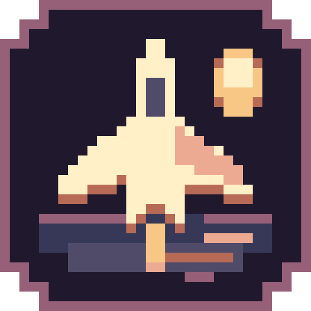
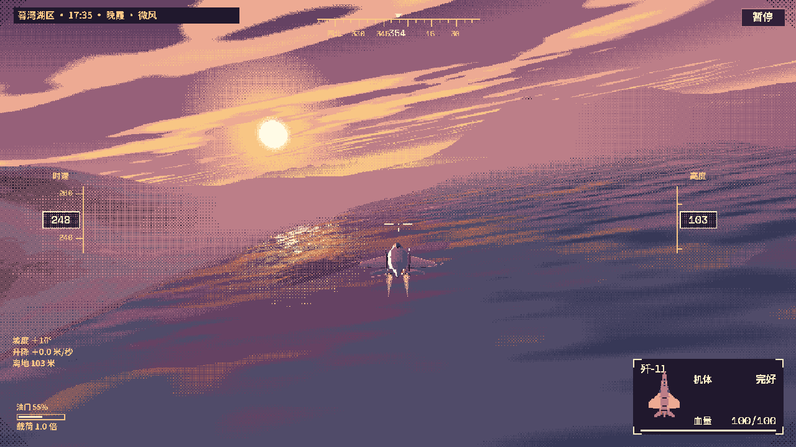
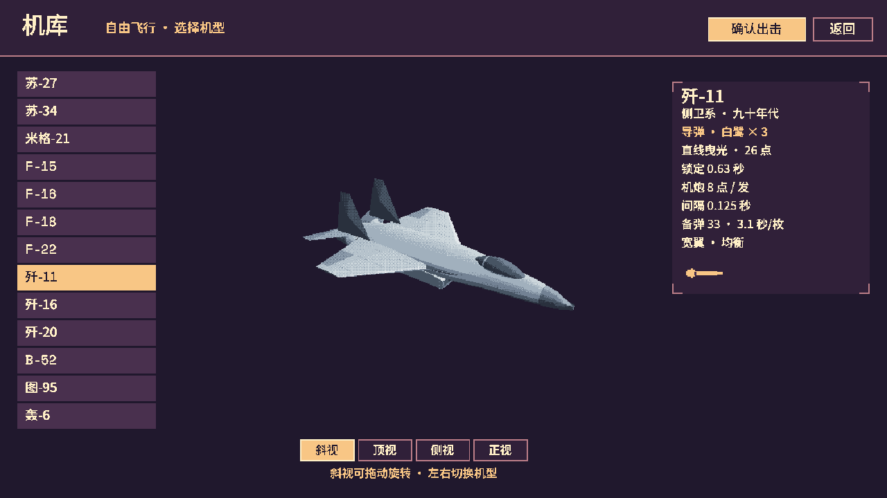
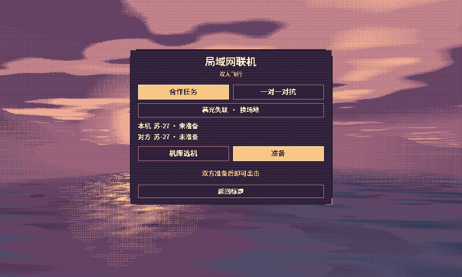

  

<h1 align="center">PATROL</h1>

<strong>秋日湖区的像素飞行游戏</strong>

  <a href="https://patrol.etta.top/"><strong>直接开始游戏</strong></a>
  &nbsp;·&nbsp;
  <a href="https://github.com/Laser1209/patrol/raw/refs/heads/main/index.html"><strong>获取游戏 HTML</strong></a>
  &nbsp;·&nbsp;
  <a href="#怎么飞">怎么飞</a>
  &nbsp;·&nbsp;
  <a href="#两个人怎么飞">双人联机</a>
  &nbsp;·&nbsp;
  <a href="#english">English</a>

贴着铜色的湖面飞一圈。入弯时，山脊和晚霞会跟着机身滚过视野。从座舱看飞行仪表，或切到追尾，看整架飞机掠过日光照亮的水面。

## 你可以怎么飞

- **自由飞行** — 在晴空、低云和薄暮之间换一条航线。掠水、爬升、倒飞，或只是沿着秋日的山谷巡航。俯冲能积累速度，拉升会消耗能量，轻擦水面会溅起一串像素水花。
- **暮湾航线** — 从引航台失联开始，穿过五章逐步展开的任务。雷达上有巡航与截击无人机、移动中继车和干扰机。两章允许驾驶大型机，投送引航信标，接通撤离航线。
- **机库** — 出击前从 13 款机体中挑选。苏-27、米格-21、F-16、歼-20、B-52、图-95、轰-6 等机型各有独立外形与飞行手感。可以拖动查看机体，也可以切到顶视、侧视和正视。
- **电脑僚机** — 机库可开关僚机。在空中指挥它保持编队、协同交战或返队。驾驶大型机出击时，僚机会默认护航，雷达上可以随时找到它。
- **双人联机** — 在联合闯关里迎战五波敌机，最后挑战空天母舰。也可以到南岸打一场 150 秒的空中对决，搭配特殊弹和机体配件。

| 暮湾湖区 | 歼-11 机库预览 |
| :---: | :---: |
|  |  |

## 怎么飞

下载 [`index.html`](https://github.com/Laser1209/patrol/raw/refs/heads/main/index.html) 并用浏览器打开。若链接显示为源码，在该页另存为 `index.html` 即可。

**新任务 → 选择航段 → 查看简报 → 机库选机 → 确认出击**

第一次飞行可以跟随座舱内的新手提示。单机飞行中可从暂停菜单选择 **保存并返回标题**，之后选 **继续上次** 直接续飞。进入下一章或重开本关时可以换机。

| 按键 | 操作 |
| :--- | :--- |
| `W` / `S` · `A` / `D` · `Q` / `E` | 俯仰 · 横滚 · 偏航 |
| `Shift` / `Ctrl` | 增减油门 |
| `C` | 切换座舱与追尾视角 |
| `J` · `K` · `L` · `T` | 机炮 · 导弹 · 热诱弹 · 切换锁定 |
| `U` | 切换僚机指令 |
| `B` | 在指定任务中投送信标 |
| `P` · `R` | 打开菜单 · 单机重开本关 |

手机上可使用触屏摇杆、油门和任务按钮，轻触僚机状态牌可切换指令。

### 两个人怎么飞

#### 在线邀请好友

打开 [PATROL 在线版](https://patrol.etta.top/)，选择 **邀请好友 → 创建房间**。把邀请链接发给朋友，好友点开就会加入，也可以在标题页输入十位房间码。两人准备后房主出击。游戏优先尝试直连，直连失败后自动尝试中继，房间会显示当前连接方式。

#### 离线局域网

两台设备打开同一版本的 `index.html`，接入允许设备互通的同一局域网。

1. **房主**在标题页选 **离线局域网 → 创建房间**，复制邀请文本发给朋友。
2. **加入方**选 **离线局域网 → 加入房间**，粘贴邀请，再把生成的回执发回房主。
3. **房主**点 **粘贴回执**。连上后，房主选好模式和场地，双方各自在机库选机并点击 **准备**，最后由房主点 **确认出击**。

合作模式共享任务进度和积分，队友掉线时可由电脑僚机接替。对抗模式是南岸空域的 1 对 1。联机菜单只在本机打开，联机对局也不会覆盖单机存档。

- **联合闯关**依次迎战苏系、美系、混合编队、电子战机与苏系护航、全系混编，最后挑战空天母舰。原有演习仍可在房间中切换。
- **对抗武装**可在 PvP 准备前选择 4AAM、8AAM 或远程单发弹，再装一个配件。`K` 发射普通导弹，`X` 发射特殊弹，触屏可点「特殊」。限时进度按双方剩余耐久的比例结算。

**同一个热点还是连不上？** 两台设备能上网的话，可以改用 **邀请好友**，游戏会自动尝试备用线路。只有本地网络时，请使用允许设备互通的 Wi‑Fi。

  

## English

**PATROL** is a pixel-art arcade flight game set over an autumn lake country. Fly from the cockpit or the chase camera, explore at your own pace, or follow a five-chapter campaign through changing weather and terrain. Pick from 13 aircraft in the hangar before you take off.

[Download the HTML file](https://github.com/Laser1209/patrol/raw/refs/heads/main/index.html) and open it in a browser. Choose **新任务** (New Mission), pick a sortie, read the briefing, and choose a plane in the hangar. Select **确认出击** (Take Off) to fly or **继续上次** (Continue) on the title screen to resume a saved solo sortie. Press `U` to cycle wingman orders when the AI wingman is enabled.

### Two-player multiplayer

Clear five enemy waves and take on an aerospace carrier in the co-op gauntlet, or fly a 150-second duel over the south shore. In PvP, choose a special weapon and one upgrade before takeoff. Press `K` for standard missiles or `X` for special weapons. Open [PATROL online](https://patrol.etta.top/), choose **邀请好友** (Invite a Friend) and share the room link. Your friend can open the link or enter the ten-character room code. The game tries a direct connection first and automatically tries a relay if needed.

For offline LAN play, both devices should open the same game version on the same local network.

1. The host chooses **离线局域网 → 创建房间** (Offline LAN → Create Room) and sends the invitation text.
2. The other player chooses **加入房间** (Join Room), pastes the invitation, and sends back the reply text.
3. The host pastes the reply and chooses a mode and map. Both players pick a plane and mark themselves ready, then the host starts the sortie.

In co-op, both players share mission progress and score. An AI wingman can take over if the other player disconnects. LAN matches leave solo saves intact.

If a shared hotspot blocks offline LAN connections and both devices can reach the internet, use **邀请好友** (Invite a Friend) to try the automatic relay.
