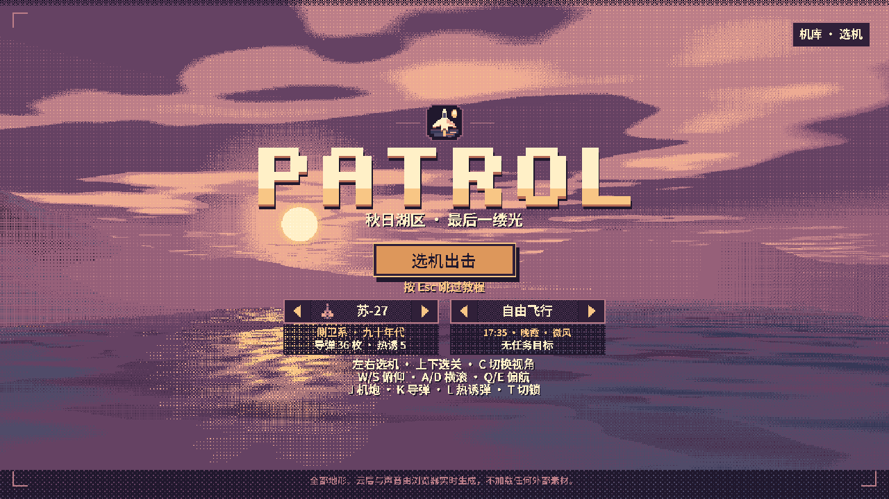

  

<h1 align="center">PATROL</h1>

<strong>秋日湖区的像素飞行游戏</strong>

  <a href="https://github.com/Laser1209/patrol/raw/refs/heads/main/index.html"><strong>获取游戏 HTML</strong></a>
  &nbsp;·&nbsp;
  <a href="#怎么飞">怎么飞</a>
  &nbsp;·&nbsp;
  <a href="#english">English</a>

贴着铜色的湖面飞一圈。入弯时，山脊和晚霞会跟着机身滚过视野。从座舱看飞行仪表，或切到追尾，看整架飞机掠过日光照亮的水面。

## 你可以怎么飞

- **自由飞行** — 在晴空、低云和薄暮之间换一条航线。掠水、爬升、倒飞，或只是沿着秋日的山谷巡航。俯冲能积累速度，拉升会消耗能量，轻擦水面会溅起一串像素水花。
- **暮湾航线** — 从引航台失联开始，穿过五章逐步展开的任务。雷达上有巡航与截击无人机、移动中继车和干扰机。两章允许驾驶大型机，投送引航信标，接通撤离航线。
- **机库** — 出击前从 13 款机体中挑选。苏-27、米格-21、F-16、歼-20、B-52、图-95、轰-6 等机型各有独立外形与飞行手感。可以拖动查看机体，也可以切到顶视、侧视和正视。
- **电脑僚机** — 在机库开启僚机，让它保持编队、协同交战或返队。驾驶大型机出击时，僚机会默认护航。
- **双人局域网** — 和朋友各自选机，在同一片湖区合作清除任务目标，或在南岸空域打一场一对一。

| 暮湾湖区 | 歼-11 机库预览 |
| :---: | :---: |
|  |  |

## 怎么飞

下载 [`index.html`](https://github.com/Laser1209/patrol/raw/refs/heads/main/index.html) 并用浏览器打开。若链接显示为源码，在该页另存为 `index.html` 即可。从 **新任务** 选择航段、查看简报，在机库挑好机型后点 **确认出击**。第一次飞行可以跟随座舱内的新手提示。

| 按键 | 操作 |
| :--- | :--- |
| `W` / `S` · `A` / `D` · `Q` / `E` | 俯仰 · 横滚 · 偏航 |
| `Shift` / `Ctrl` | 增减油门 |
| `C` | 切换座舱与追尾视角 |
| `J` · `K` · `L` · `T` | 机炮 · 导弹 · 热诱弹 · 切换锁定 |
| `U` | 切换僚机指令 |
| `P` | 暂停，可保存并退出 |

手机上可使用触屏摇杆、油门和任务按钮。中途保存退出后，在标题页选择 **继续上次** 即可续飞。

### 两个人怎么飞

两台设备打开同一版本的游戏，接入同一局域网。在 **局域网** 中由一方创建房间并发送邀请文本，另一方加入后将回执文本发回。房主把回执粘贴到游戏里，两人选机并准备，就可以出击。首版采用浏览器直连，连接是否可用取决于网络与浏览器设置。

## English

**PATROL** is a pixel-art arcade flight game set over an autumn lake country. Fly from the cockpit or the chase camera, explore at your own pace, or follow a five-chapter campaign through changing weather and terrain. Pick from 13 aircraft in the hangar before you take off.

[Download the HTML file](https://github.com/Laser1209/patrol/raw/refs/heads/main/index.html) and open it in a browser. Choose **新任务** (New Mission), read the briefing and select an aircraft, then choose **确认出击** (Take Off). Choose **继续上次** (Continue) to resume a saved solo sortie.

Fly solo with an optional AI wingman, or choose **局域网** (LAN) for two-player co-op and duels. Open the same game version on both devices on the same network, exchange the invitation and reply texts, then select your aircraft and mark both pilots ready.
